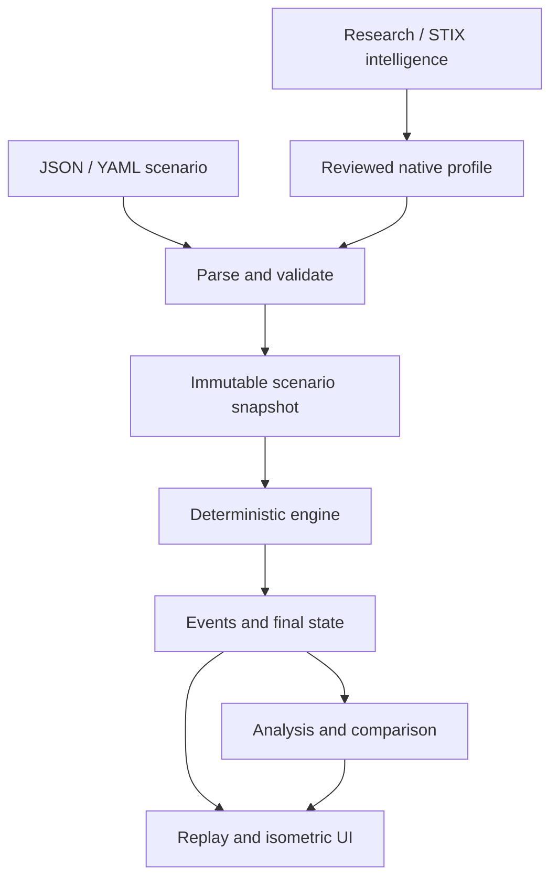

# Rzero architecture

Status: proposed implementation contract, revision 0.1 — 12 October 2026.

## Product contract

Given a modeled network, a reviewed malware behavior profile, one initially compromised asset, and explicit defensive conditions, Rzero determines which assets become compromised under those assumptions. It explains each attempted movement, replays the result visually, and compares a baseline against a modified scenario.

The product is a network threat-modeling laboratory. A result describes consequences of supplied assumptions; it is not a prediction of actual incident timing or proof that a real exploit will succeed.

## V1 release boundary

V1 includes scenario import in JSON and restricted YAML; built-in demonstrations; two mechanism evaluators (vulnerability-based remote exploitation and credential-based remote execution); explicit reachability, services, vulnerability status, credential grants and static controls; deterministic propagation; event replay; first-compromise paths; blast radius; and one-change baseline comparison. The interface follows the supplied isometric references.

Ship a synthetic profile for precise tests and two small, reviewed profiles based on public malware research. Select those real profiles only after checking that their documented preconditions fit the implemented mechanisms. Unsupported family behavior must appear as an omission, not an invented rule. A family name alone is insufficient for simulation.

STIX 2.1, ATT&CK and MBC inform curated profile authoring. Automated STIX ingestion, hash enrichment and remote API calls are later work. V1 accepts the native Rzero profile contract, not arbitrary STIX bundles.

Scanning, live exploitation, executable malware ingestion, packet simulation, Active Directory emulation, probabilistic EDR outcomes, dynamic incident response, optimization and automatic recommendations are outside this release. There is no dependency on another Project Trinity project.

## Data flow and ownership

| Subsystem | Owns | Must not own |
| --- | --- | --- |
| Network model | Static assets, links and environmental facts | Compromise state or animations |
| Profile model | Capabilities, requirements, evidence | Network-specific outcomes |
| Scenario compiler | Resolved input, interventions, canonicalization | Traversal decisions |
| Engine | Queue, discovery, attempts, compromise state | Layout, playback speed, external lookups |
| Event contract | Ordered facts and machine-readable explanations | DOM state or generic log strings |
| Analysis | Counts, parent paths, scenario differences | New propagation decisions |
| Frontend | Selection, camera, replay cursor, rendering | Deciding compromise |

## Shared decisions

1. Input is immutable during a run. An edit creates a new scenario and run.
2. Evaluation is deterministic and uses logical hop depth, not elapsed seconds.
3. Missing knowledge cannot silently become either vulnerability or safety.
4. Network links are directed and service-specific. Denied modeled links remain explainable candidates; missing links produce no attempt.
5. Blocking is an attempt outcome, not a permanent host state.
6. Each asset is compromised at most once and processes outgoing links once.
7. Profile confidence is evidence metadata, never a success probability.
8. Comparison starts both runs from the same initial asset and uses the same engine/profile versions.

These rules are authoritative across the document set. Any implementation change affecting them requires a documented decision and updated canonical scenarios.

## Implementation default

For a new repository, use a TypeScript domain core with no browser dependencies, a browser worker for simulation, and an SVG renderer for the projected isometric map. Share the core with a small command-line runner and unit tests. This gives one implementation to validate and avoids a server deployment requirement for V1. The 3D appearance is a 2D projection; a WebGL engine is unnecessary at the proposed scale.

This is a proposed implementation choice, not a previously selected user requirement. If an existing repository imposes another stack, preserve the contracts and explain the tradeoff before changing them. Keep serialization adapters and renderer replaceable. Do not introduce a database, microservices, authentication or an LLM dependency to complete this slice.

Proposed module boundaries: `domain/`, `io/`, `engine/`, `analysis/`, `replay/`, `ui/`, `fixtures/` and `docs/`. Import direction runs from adapters/UI toward core contracts, never from engine toward UI.

## Scale and reproducibility

Initial admission limits: 5 MiB per imported document, 250 assets, 2,000 directed links, four capabilities per profile and 50,000 events per run. These are V1 product limits, not benchmark claims. Reject oversize scenarios clearly; never return a partial result labeled complete.

Every export retains the effective scenario, canonical input digest, model version, engine version, ordered events, result and profile evidence. Runtime duration, wall-clock export date and UI camera settings are separate metadata and do not affect deterministic results.

## Definition of done

Canonical scenarios pass; imports validate with precise field paths; baseline and modified runs remain isolated; every compromise links to a resolved successful attempt; replay reaches the engine's final state; unknowns remain visible; and the reference-inspired UI remains readable with animation disabled. Detailed gates and build order are in `implementation-plan.md`.
